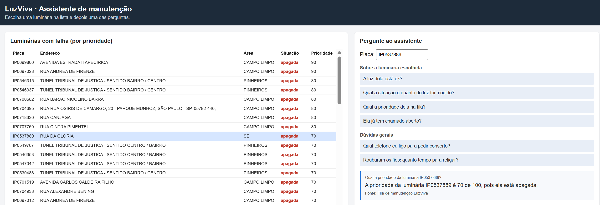

# LuzViva - Assistente de IA

Generative AI for Engineering - Global Solution 2026.2 - 4-ESPY

## Integrantes

- Caíque Walter Silva - RM550693
- Guilherme Monteiro Espim - RM99499
- Guilherme Nobre Bernardo - RM98604
- João Paulo Fonseca Zamperlini - RM99279
- Matheus José de Lima Costa - RM551157

## Ficha Técnica

- **Produto:** LuzViva
- **Problema:** Atualmente no estado de São Paulo, só é possível descobrir que uma luminária apagou quando alguém reclama, e a rua fica escura e insegura
- **Território Simulado:** Sé, Pinheiros e Campo Limpo (São Paulo)
- **O que a IA faz:** responde dúvidas sobre a manutenção da iluminação pública citando a fonte, e caso não encontre a resposta, diz "não consta".
- **Modelo:** Qwen2.5-1.5B-Instruct, rodando local
- **ODS:** 11, 9 e 10

## Como funciona

1. A busca acha os 3 trechos dos documentos mais parecidos com a pergunta (RAG).
2. Se a pergunta tem uma placa (ex.: IP0699800), a ferramenta `consultar_fila` pega os dados da luminária.
3. O modelo lê esse contexto e responde em JSON.

O código está em `api.py`. A avaliação está em `notebooks/assistente.ipynb`.



No site, você escolhe uma luminária na lista e clica numa pergunta. A resposta mostra a fonte usada.

## 01. Tarefa e testes

A IA responde sobre manutenção da iluminação: prazo, responsável, como pedir conserto e situação de uma luminária.

A prova (`avaliacao/prova.jsonl`) tem 47 perguntas com gabarito: 30 sobre os documentos, 7 sobre luminárias e 10 que não constam na base.

## 02. Base de conhecimento

`base/documentos.jsonl` tem 47 trechos, cada um com título e link.

| Fonte | Formato | Licença | Trechos |
|---|---|---|---|
| SP Regula | HTML | Informação pública | 29 |
| Câmara Municipal de SP | HTML | Conteúdo público | 2 |
| ANEEL REN 1.000/2021 | PDF | Ato oficial | 2 |
| LGPD | HTML | Lei | 6 |
| Regras do LuzViva | Markdown | Própria | 8 |

`base/luminarias.json` tem 99 luminárias com falha (dados simulados).

## 03. Busca e limiar

- recall@1: 0,70
- recall@3: 0,77
- Limiar: 0,86 (abaixo disso a resposta é "não consta")

O limiar 0,86 deixa passar 25 das 30 perguntas com resposta e barra 9 das 10 que não constam (`avaliacao/limiar.png`).

## 04. JSON, citação e recusa

Toda resposta sai no formato `{"resposta", "fontes", "recusou", "confianca"}`. O JSON é garantido pela decodificação restrita (xgrammar). O prompt manda usar só o contexto, citar a fonte e dizer "não consta" quando não souber.

## 05. Especialização: agente

A ferramenta `consultar_fila(placa)` traz os dados da luminária, que nenhum documento tem. No começo o modelo decidia quando chamar a ferramenta e só chamou em 4 de 7 perguntas, então passamos essa decisão para o código (regex da placa).

## 06. Placar

| Config | Acerto total | Acerto factual | Citou fonte | Recusa correta | Recusa indevida | JSON válido |
|---|---|---|---|---|---|---|
| A - só o modelo | 0,04 | 0,05 | 0,00 | 0,90 | 0,73 | 0,36 |
| B - RAG | 0,34 | 0,54 | 0,22 | 0,90 | 0,27 | 0,70 |
| C - RAG + agente | 0,53 | 0,62 | 0,51 | 1,00 | 0,14 | 1,00 |

- **A** inventa: mandou ligar para "158" (o certo é 0800 779 0156). 82% das respostas que deu estavam erradas.
- **B** acerta bem mais: 54% de acerto e 29% de respostas erradas.
- **C** é a melhor: responde as luminárias, recusa tudo que não consta e o JSON sai sempre válido.

## 07. Cinco erros reais

| Pergunta | O que respondeu | Causa | Correção |
|---|---|---|---|
| A IP0697028 tem chamado aberto? | "Sim" (certo), sem fonte | Não preencheu a fonte | Pôr a fonte no código |
| O que a LGPD considera dado pessoal? | "Não consta" | Nota 0,856, abaixo do limiar | Busca melhor |
| De quem é a manutenção, pela ANEEL? | Citou uma lei inventada | A busca não trouxe o art. 451 | Só aceitar fontes da busca |
| A prefeitura precisa do meu consentimento? | "Sim" (o certo é não) | Leu o inciso errado | Um trecho por inciso |
| Em quanto tempo a luminária é atendida? | "Imediatamente" (certo: 24 h) | A busca trouxe o trecho errado | Busca por palavra-chave |

## 08. Como rodar

Dois cliques em `rodar.bat`: ele instala o que falta e abre o site em `http://localhost:8001`.

Ou manualmente:

```bash
pip install -r requirements.txt
uvicorn api:app --port 8001
```

A primeira execução baixa o modelo (~3 GB).

## Conclusão

Com os documentos e os dados das luminárias, o mesmo modelo passa de 5% para 62% de acerto, e as respostas erradas caem de 82% para 28%. A IA não guarda as perguntas nem tem dados pessoais (LGPD).

**Links:** 

Repositório: https://github.com/GS-LuzViva/IA-Generativa
Vídeo : (https://youtu.be/IdpS3Oqmkws)
