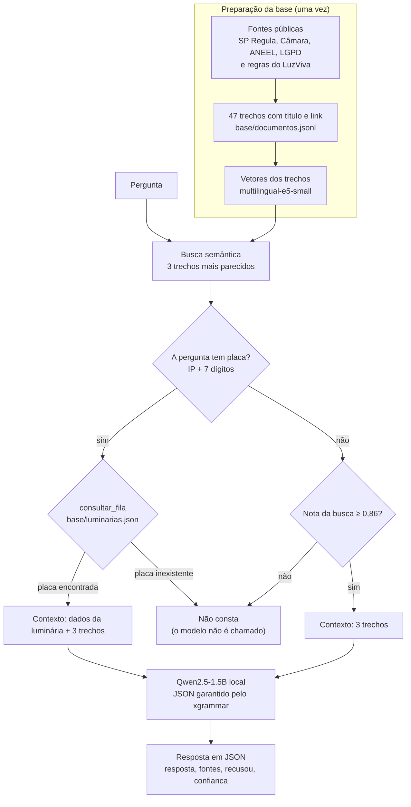

# LuzViva - Assistente de IA

Generative AI for Engineering - Global Solution 2026.2 - 4-ESPY

## Integrantes

- Caíque Walter Silva - RM550693
- Guilherme Monteiro Espim - RM99499
- Guilherme Nobre Bernardo - RM98604
- João Paulo Fonseca Zamperlini - RM99279
- Matheus José de Lima Costa - RM551157

## Ficha Técnica

| Campo | Conteúdo |
|---|---|
| Nome do produto | LuzViva |
| Cidadão e território | Pessoas que circulam à noite nas áreas-piloto Sé, Pinheiros e Campo Limpo, na cidade de São Paulo |
| Problema, em uma frase | Na cidade de São Paulo, uma luminária apagada só é identificada quando um morador registra uma reclamação; até o reparo, a via permanece escura e insegura |
| Proposta de valor | Encontrar a falha antes da reclamação e indicar ao gestor o que consertar primeiro |
| O que a IA resolve | Responde dúvidas sobre a manutenção da iluminação pública e sobre a situação de cada luminária, citando a fonte; quando a informação não está na base, responde "não consta" |
| Arquitetura | Busca semântica nos documentos (RAG), ferramenta `consultar_fila` com os dados das luminárias e LLM local com saída em JSON, expostos pela API `POST /perguntar` |
| Fontes de dados | SP Regula, Câmara Municipal de São Paulo, ANEEL, LGPD e regras do LuzViva (47 trechos); 99 luminárias com falha (dados simulados) |
| Modelos de IA | Qwen2.5-1.5B-Instruct (local) e embeddings `intfloat/multilingual-e5-small` |
| URL do MVP e repositório | MVP: http://52.67.217.30 · Repositório: https://github.com/GS-LuzViva/IA-Generativa |
| Indicadores de impacto | % de falhas encontradas antes de relato; tempo até o reparo; horas-luminária no escuro por noite |
| ODS | 11, 9 e 10 |

## Pipeline de IA



O código está em `api.py`, e a avaliação completa em `notebooks/assistente.ipynb`.


Na interface, o usuário escolhe uma luminária da lista e seleciona uma pergunta; a resposta exibe a fonte utilizada.

## 01. Tarefa e testes

A IA responde sobre a manutenção da iluminação pública: prazos, responsáveis, como solicitar o conserto e a situação de uma luminária específica.

A prova (`avaliacao/prova.jsonl`) contém 47 perguntas com gabarito: 30 sobre os documentos, 7 sobre luminárias e 10 cuja resposta não consta na base.

## 02. Base de conhecimento

O arquivo `base/documentos.jsonl` contém 47 trechos, cada um com título e link da fonte.

| Fonte | Formato | Licença | Trechos |
|---|---|---|---|
| SP Regula | HTML | Informação pública | 29 |
| Câmara Municipal de SP | HTML | Conteúdo público | 2 |
| ANEEL REN 1.000/2021 | PDF | Ato oficial | 2 |
| LGPD | HTML | Lei | 6 |
| Regras do LuzViva | Markdown | Própria | 8 |

O arquivo `base/luminarias.json` contém 99 luminárias com falha (dados simulados).

## 03. Busca e limiar

- recall@1: 0,70
- recall@3: 0,77
- Limiar: 0,86 (abaixo dele, a resposta é "não consta" e o modelo não é chamado)

Com o limiar de 0,86, passam 25 das 30 perguntas que têm resposta, e são barradas 9 das 10 que não constam na base (`avaliacao/limiar.png`).

## 04. JSON, citação e recusa

Toda resposta segue o formato `{"resposta", "fontes", "recusou", "confianca"}`. O JSON é garantido por decodificação restrita (xgrammar), que impede o modelo de gerar texto fora do esquema. O prompt determina o uso exclusivo do contexto, a citação da fonte e a resposta "não consta" quando a informação não estiver disponível.

## 05. Especialização: agente

A ferramenta `consultar_fila(placa)` fornece os dados da luminária, que nenhum documento contém. Inicialmente, o próprio modelo decidia quando acionar a ferramenta e o fez em apenas 4 de 7 perguntas; por isso, essa decisão passou a ser feita no código, pela identificação da placa na pergunta.

## 06. Placar

| Config | Acerto total | Acerto factual | Citou fonte | Recusa correta | Recusa indevida | JSON válido |
|---|---|---|---|---|---|---|
| A - só o modelo | 0,04 | 0,05 | 0,00 | 0,90 | 0,73 | 0,36 |
| B - RAG | 0,34 | 0,54 | 0,22 | 0,90 | 0,27 | 0,70 |
| C - RAG + agente | 0,53 | 0,62 | 0,51 | 1,00 | 0,14 | 1,00 |

- **A (só o modelo)** alucina: indicou o telefone "158" (o correto é 0800 779 0156), e 82% das respostas fornecidas estavam erradas.
- **B (RAG)** eleva o acerto factual para 54% e reduz as respostas erradas para 29%.
- **C (RAG + agente)** apresenta o melhor desempenho: responde sobre as luminárias, recusa todas as perguntas sem resposta na base e gera JSON válido em 100% dos casos.

## 07. Cinco erros reais

| Pergunta | Resposta obtida | Causa | Correção proposta |
|---|---|---|---|
| A IP0697028 tem chamado aberto? | "Sim" (correto), sem fonte | O modelo não preencheu o campo de fontes | Preencher a fonte no código ("Fila de manutenção LuzViva") sempre que a ferramenta for usada |
| O que a LGPD considera dado pessoal? | "Não consta" | Nota da busca de 0,856, logo abaixo do limiar | Busca híbrida (vetores + palavra-chave), que favorece o trecho que contém "dado pessoal" |
| De quem é a manutenção, pela ANEEL? | Citou uma lei inexistente | A busca não recuperou o art. 451 | Validar no código que toda fonte citada está entre os trechos recuperados, descartando as demais |
| A prefeitura precisa do meu consentimento? | "Sim" (o correto é não) | O trecho trazia vários incisos, e o modelo leu o errado | Dividir a LGPD em um trecho por inciso, para que o contexto traga apenas o inciso relevante |
| Em quanto tempo a luminária é atendida? | "Imediatamente" (o correto é 24 h) | A busca recuperou o trecho errado | Reordenar os trechos recuperados com um modelo de re-ranking ou com busca híbrida |

## 08. Execução

Basta executar o arquivo `rodar.bat`, que instala as dependências necessárias e abre a interface em `http://localhost:8001`.

Execução manual:

```bash
pip install -r requirements.txt
uvicorn api:app --port 8001
```

Na primeira execução, o modelo é baixado (cerca de 3 GB).

## Conclusão

Com os documentos e os dados das luminárias, o mesmo modelo passa de 5% para 62% de acerto factual, e as respostas erradas caem de 82% para 28%. A IA não armazena as perguntas e não utiliza dados pessoais (LGPD).

**Links:**

- Repositório: https://github.com/GS-LuzViva/IA-Generativa
- Vídeo: https://youtu.be/IdpS3Oqmkws
